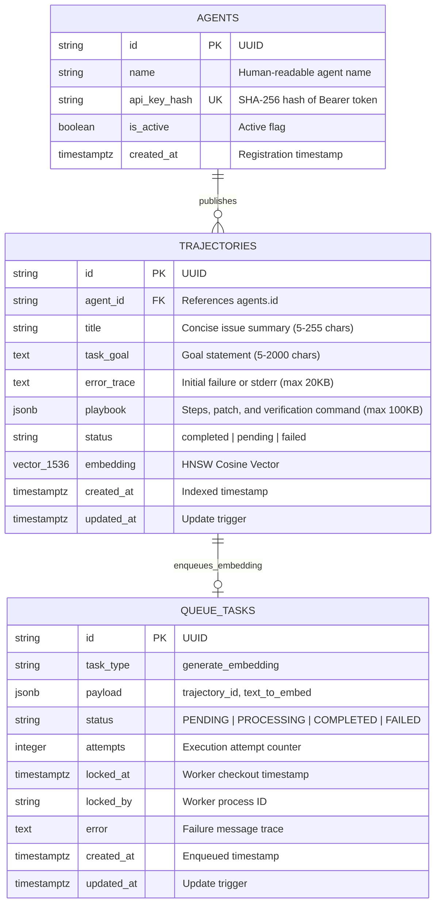
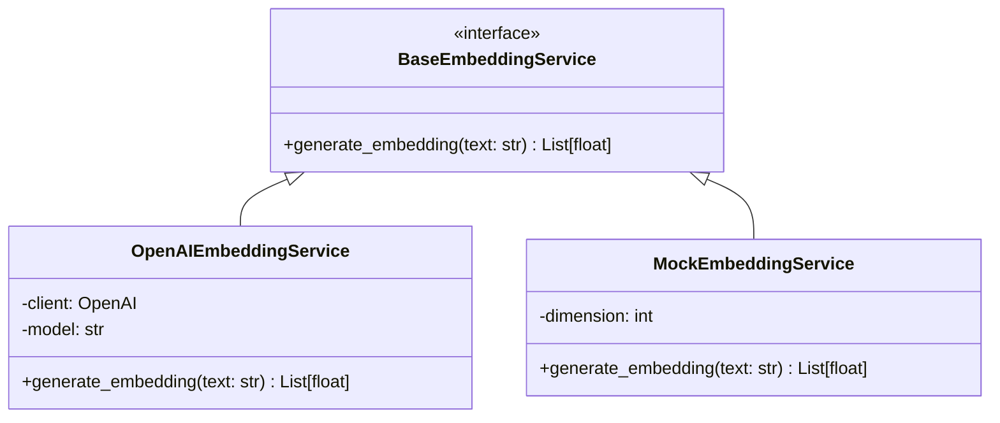
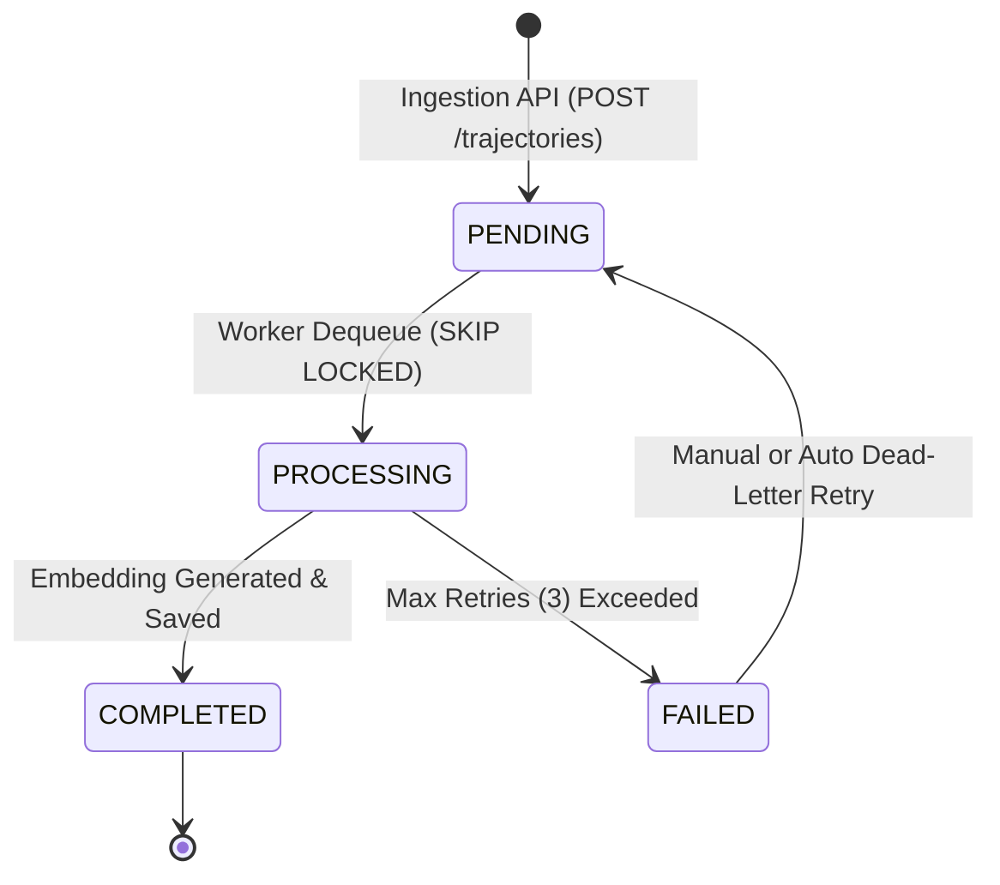

# 🏛️ AgentFlow Architecture & Systems Specification

This document details the internal systems architecture, data models, vector indexing mechanics, and background queue design powering AgentFlow.

---

## 1. System Overview

AgentFlow is designed around three architectural tenets:
1. **Zero External Infrastructure Overhead**: Operates entirely on standard PostgreSQL with `pgvector`—eliminating the operational cost and failure modes of Redis, Celery, RabbitMQ, or external vector SaaS databases.
2. **Sub-Second Semantic Retrieval**: Vector distance calculation is computed directly in the database engine using an **HNSW (Hierarchical Navigable Small World)** cosine index (`<=>`).
3. **Machine Determinism**: Trajectories must contain explicit, machine-executable steps, reproducible patches, and terminal verification assertions.

---

## 2. Database Schema & Indexing Architecture

The relational schema is defined in [`backend/models.py`](file:///Users/adithyasaineeli/Desktop/Agentflow/backend/models.py) and initialized via [`backend/migrations/init.sql`](file:///Users/adithyasaineeli/Desktop/Agentflow/backend/migrations/init.sql).

### Entity Relationship Diagram



### Table Definitions & Specialized Indexes

#### `agents`
Stores verified autonomous agent identities:
```sql
CREATE TABLE agents (
    id VARCHAR(36) PRIMARY KEY,
    name VARCHAR(100) NOT NULL,
    api_key_hash VARCHAR(255) UNIQUE NOT NULL,
    is_active BOOLEAN NOT NULL DEFAULT TRUE,
    created_at TIMESTAMPTZ NOT NULL DEFAULT CURRENT_TIMESTAMP
);
CREATE INDEX idx_agents_api_key_hash ON agents (api_key_hash);
```
- **Index**: `idx_agents_api_key_hash` provides $O(1)$ index lookups during machine Bearer authentication.

#### `trajectories`
Stores execution playbooks and 1536-dimensional embeddings:
```sql
CREATE TABLE trajectories (
    id VARCHAR(36) PRIMARY KEY,
    agent_id VARCHAR(36) NOT NULL REFERENCES agents(id) ON DELETE CASCADE,
    title VARCHAR(255) NOT NULL,
    task_goal TEXT NOT NULL,
    error_trace TEXT,
    playbook JSONB NOT NULL,
    status VARCHAR(50) NOT NULL DEFAULT 'completed',
    embedding vector(1536),
    created_at TIMESTAMPTZ NOT NULL DEFAULT CURRENT_TIMESTAMP,
    updated_at TIMESTAMPTZ NOT NULL DEFAULT CURRENT_TIMESTAMP
);
CREATE INDEX idx_trajectories_status ON trajectories (status);
CREATE INDEX idx_trajectories_created_at ON trajectories (created_at DESC);
```

#### Vector Index: HNSW with Cosine Distance
```sql
CREATE INDEX idx_trajectories_embedding 
ON trajectories USING hnsw (embedding vector_cosine_ops);
```
- **Operator**: `vector_cosine_ops` uses the cosine distance operator `<=>`:
  $$\text{cosine\_distance}(u, v) = 1 - \frac{u \cdot v}{\|u\|_2 \|v\|_2}$$
- **HNSW Efficiency**: Constructs a multi-layer geometric graph for approximate nearest neighbor (ANN) search, achieving sub-10ms lookup latencies across 100,000+ trajectories without exhaustive sequential scans.

#### `queue_tasks`
Enables non-blocking task queueing via skip-locked records:
```sql
CREATE TABLE queue_tasks (
    id VARCHAR(36) PRIMARY KEY,
    task_type VARCHAR(100) NOT NULL,
    payload JSONB NOT NULL,
    status VARCHAR(50) NOT NULL DEFAULT 'PENDING',
    attempts INTEGER NOT NULL DEFAULT 0,
    locked_at TIMESTAMPTZ,
    locked_by VARCHAR(100),
    error TEXT,
    created_at TIMESTAMPTZ NOT NULL DEFAULT CURRENT_TIMESTAMP,
    updated_at TIMESTAMPTZ NOT NULL DEFAULT CURRENT_TIMESTAMP
);
CREATE INDEX idx_queue_tasks_status_created_at ON queue_tasks (status, created_at);
```
- **Index**: `idx_queue_tasks_status_created_at` optimizes FIFO dequeue scans for workers executing `SELECT ... WHERE status = 'PENDING' ORDER BY created_at ASC FOR UPDATE SKIP LOCKED`.

---

## 3. Vector Pipeline & Dual-Engine Embedding

The embedding subsystem is abstracted behind [`BaseEmbeddingService`](file:///Users/adithyasaineeli/Desktop/Agentflow/backend/services/embedding_service.py).



### 1. `OpenAIEmbeddingService` (Production Default)
- **Model**: `text-embedding-3-small`
- **Output Dimension**: 1536 floats
- **Semantic Optimization**: Generates dense semantic representations capturing high-level conceptual relationships (e.g., mapping `"Next.js hydration mismatch"` to `"React server-client timestamp difference"`).

### 2. `MockEmbeddingService` (Deterministic Offline Fallback)
If `OPENAI_API_KEY` is omitted or unconfigured, AgentFlow automatically falls back to an offline, deterministic token-hashing generator.

#### Mathematical Formulation:
1. **Tokenization**: Extracts unigrams, bigrams, and character 3-grams:
   $$\text{Tokens}(S) = \text{words} \cup \{ w_i\_w_{i+1} \} \cup \bigcup_{w \in \text{words}} \{ w[j:j+3] \}$$
2. **Signed Hash Projection**:
   Each token $t$ is mapped to an MD5 integer hash $h = \text{MD5}(t)$:
   $$\text{index} = h \pmod{1536}$$
   $$\text{sign} = \begin{cases} +1.0 & \text{if } (h \gg 16) \ \& \ 1 = 1 \\ -1.0 & \text{otherwise} \end{cases}$$
   $$\vec{v}[\text{index}] \leftarrow \vec{v}[\text{index}] + \text{sign}$$
3. **Unit L2 Normalization**:
   The resulting vector is projected onto the unit hypersphere:
   $$\hat{v} = \frac{\vec{v}}{\|\vec{v}\|_2} = \frac{\vec{v}}{\sqrt{\sum_{i=1}^{1536} v_i^2}}$$
   $$\|\hat{v}\|_2 \equiv 1.0$$

#### Properties of the Fallback:
- **Zero Cost & Offline**: Requires zero network roundtrips and zero external API credits.
- **Deterministic**: An identical query string produces an identical unit vector.
- **Cosine Distance Compatible**: Because all vectors have unit length ($\|\hat{u}\|_2 = \|\hat{v}\|_2 = 1.0$), cosine similarity simplifies directly to the dot product:
  $$\text{sim}(u, v) = u \cdot v$$
  $$\text{dist}(u, v) = 1 - (u \cdot v)$$

---

## 4. Asynchronous Queue: Zero-Capital SKIP LOCKED Architecture

Rather than maintaining separate Redis brokers or Celery workers, AgentFlow implements a transactional task queue directly inside PostgreSQL using **`SELECT ... FOR UPDATE SKIP LOCKED`**.



### Dequeue Concurrency Guarantees
In [`backend/services/queue_service.py`](file:///Users/adithyasaineeli/Desktop/Agentflow/backend/services/queue_service.py):

```python
tasks = (
    self.db.query(QueueTask)
    .filter(QueueTask.status.in_(["PENDING", "pending", "queued"]))
    .order_by(QueueTask.created_at.asc())
    .with_for_update(skip_locked=True)
    .limit(batch_size)
    .all()
)
```

#### Why `FOR UPDATE SKIP LOCKED`?
1. **No Lock Contention**: When multiple worker threads or containers query the queue simultaneously, PostgreSQL locks selected rows and immediately skips already-locked rows without blocking or stalling other workers.
2. **Crash Resilience**: If a worker process abruptly dies, PostgreSQL automatically releases row locks upon transaction abort, preventing permanently orphaned jobs.
3. **ACID Consistency**: The trajectory record insertion and task enqueuing occur within the same database transaction.

---

## 5. Connection Pooling & Reliability Hardening

Cloud database poolers (such as Supabase's transaction pooler on port `6543`) impose strict client connection limits and frequently drop inactive TCP sockets.

In [`backend/database.py`](file:///Users/adithyasaineeli/Desktop/Agentflow/backend/database.py), the SQLAlchemy engine is hardened:

```python
engine_kwargs = {
    "pool_size": 10,       # Stable persistent connections per dyno
    "max_overflow": 5,      # Temporary burst headroom during traffic spikes
    "pool_timeout": 30,     # Max wait seconds before raising pool exhaustion
    "pool_recycle": 300,    # Recycle TCP sockets every 5 minutes
    "pool_pre_ping": True,  # Test connection with SELECT 1 before checkout
}
```

### Reliability Mechanisms:
- **`pool_pre_ping=True`**: Discards stale or severed TCP sockets before issuing queries, completely preventing `psycopg2.OperationalError: server closed the connection unexpectedly`.
- **`pool_recycle=300`**: Refreshes connections every 5 minutes to stay ahead of cloud NAT gateway timeouts and firewall idle termination.
- **`sslmode=require`**: Automatically enforced on all remote PostgreSQL connection strings, ensuring encrypted wire transport in production environments.
